# MikrotikEasy

[](LICENSE)
[](https://github.com/rmukhtarov/mikrotikeasy/releases)
[](https://github.com/rmukhtarov/mikrotikeasy/pkgs/container/mikrotikeasy)
[](https://claude.com/claude-code)

Step-by-step configuration of MikroTik routers for people who do not know RouterOS. Answer a few
questions, watch the result on a live diagram, and get a ready RouterOS v6 or v7 script. The interface is
available in Azerbaijani, Russian and English.

## Features

The pictures below are generated from the app's own live diagram (`node tools/make-docs.mjs`). In the app
they update as you fill in the form, the active step lights up, and a click on any part opens its step.

- Green dots show your internet traffic.
- Red dots show unwanted connections from outside.
- Orange dots show access from outside that you allowed.

### Master (setup wizard)

The Master builds the script from fixed templates, with no LLM involved, so the same answers always give the
same script. The answers are checked as you go, and the result is validated against a RouterOS command
schema and server-side lint rules.

<p align="center"></p>

### Internet and failover

<p align="center"></p>

- **Connection types:** DHCP, static IP, PPPoE, or an LTE modem (built-in or USB, with APN and SIM PIN).
- **Second line with failover:** recursive checks that ping real internet hosts, so failover also happens
  when the provider fails and not only when the cable is pulled. A simple gateway check is also available.
- **Failover simulation:** *Cut the main line* in the app shows the traffic moving to the backup.

### Ports: which cable goes where

<p align="center"></p>

- **Role for every port:** local network, guest, cameras, or disabled. A disabled port is switched off
  completely.
- **Port notes:** a free-text note such as *1st floor switch port 5* becomes the port comment in Winbox. The
  port map in the app lists every port with its role and note.
- **Speed limits:** per port in hardware (RB3011, RB2011), and per device or IP range with simple queues.
  FastTrack is turned off automatically when queues are used.
- **LAN size:** any size from /16 to /30, with a DHCP server and an automatic range.

### Guest, camera and WiFi networks

<p align="center"></p>

- **Guest network:** guests reach the internet but cannot see your devices.
- **Camera network:** cameras cannot reach the LAN, while the LAN can still watch them. Their internet access
  is optional and off by default (time sync only), so cameras cannot send video to vendor clouds.
- **WiFi:** the `wifi` package (hAP ax) or the `wireless` package (hAP ac, LTE models), each with its own
  guest WiFi.

### Protection and access from outside

<p align="center"></p>

- **Firewall and hardening:** included in every script. Unwanted connections from the internet are dropped,
  management services are limited to the LAN, and services that are not needed are turned off.
- **Port forwarding:** with hairpin NAT and an optional source address limit.
- **Port scan protection and bogon filter:** both are on by default.
- **Country filter:** allows the port forwards only from the chosen countries, or blocks the chosen
  countries. The lists come from iwik.org; the router refreshes them daily and checks them before
  importing, and the app shows how fresh each list is.

### AI assistant (optional)

- **What it does:** turns a free-text description into a RouterOS v6 or v7 script, or reviews a pasted
  `/export`.
- **LLM:** any OpenAI-compatible endpoint works, such as LocalAI, Ollama, LM Studio or a hosted API.
- **Checks:** each answer goes through lint, a schema check and automatic fix passes.
- **Turning it off:** with the AI off, the app becomes a plain configurator with no AI wording and makes no
  LLM calls.

### Settings (gear icon)

- **What you can change:** turn the AI on or off, and set the LLM address, API key, model and limits from
  the app. *Test connection* lists the endpoint's models.
- **Where values are saved:** on the data volume, overriding `.env`. `.env` stays as the fallback, and *Back
  to .env* returns to it.
- **API key:** encrypted on the server (AES-256-GCM), never shown in the browser, and only sent to the
  address it was saved for.
- **No login:** anyone who can open the app can change these settings. If the network is not trusted, put
  the app behind a reverse proxy with authentication.

### Runs anywhere

- **Platforms:** Docker (linux/amd64 and linux/arm64), Portainer, Arcane, plain Node.js, or a single `.exe`
  for Windows x64 and x86.
- **Languages:** Azerbaijani, Russian and English.
- **RouterOS:** versions 6 (6.45+) and 7.

## Quick start (Docker)

```sh
git clone https://github.com/rmukhtarov/mikrotikeasy.git
cd mikrotikeasy
sh install.sh
```

`install.sh` checks Docker and Compose, creates `.env` from `.env.example` and creates the data folder. It
then starts the app from one of three sources, in this order:

1. an image file next to the script
2. the published image `ghcr.io/rmukhtarov/mikrotikeasy`
3. a build from source

Finally it waits for the health check. Open `http://<host>:3090` when it finishes.

| Use case | How to run |
|---|---|
| Published image | `docker compose up -d` |
| Build from source | `docker compose -f docker-compose.yml -f docker-compose.build.yml up -d --build` |
| Offline host | Put `mikrotikeasy-image-<version>.tar.gz` from the release next to `install.sh`, then run `sh install.sh` |
| Portainer or Arcane | Paste `docker-compose.yml` and add the `.env` values as stack variables. Set `DATA_DIR` explicitly, because Portainer has no `$USER`. |
| Plain Docker | `docker run -d --name mikrotikeasy -p 3090:3090 -v /srv/mikrotikeasy:/data --env-file .env ghcr.io/rmukhtarov/mikrotikeasy:1.1.0` |
| Without Docker (Node.js 18 or newer, no npm packages) | `cp .env.example .env && node server.mjs` |

## Windows (single .exe, no installation)

Download `MikrotikEasy-<version>-win-x64.exe` (64-bit Windows) or `-win-x86.exe` (32-bit) from the
[releases](https://github.com/rmukhtarov/mikrotikeasy/releases) and double-click it.

- The app opens in your browser at `http://127.0.0.1:3090`. If that port is taken, it tries the next ports.
- Keep the console window open while you use the app. Closing the window stops it.
- Settings, the encrypted API key and the AI mistake memory are kept in `%LOCALAPPDATA%\MikrotikEasy`. An
  optional `.env` file is read from that folder or from the folder next to the `.exe`.
- The `.exe` is not code-signed, so Windows SmartScreen may warn the first time. Click *More info* and then
  *Run anyway*. Compare the file with `SHA256SUMS.txt` from the release.
- `NO_BROWSER=1` starts the app without opening a browser. `HOST=0.0.0.0` lets other computers on the LAN
  open it.

Build the executables yourself on Windows with the same Node.js 22 version: `node tools/build-exe.mjs`. The
build uses the Node.js single executable application feature with the official `node.exe` for each
architecture, checked by SHA-256.

## Settings (`.env`)

| Variable | Default | Meaning |
|---|---|---|
| `AI_ENABLED` | empty | `true` or `false`. When empty, AI is on only if `LLM_BASE_URL` is set. |
| `LLM_BASE_URL`, `LLM_API_KEY`, `LLM_MODEL` | empty | OpenAI-compatible endpoint. Examples for LocalAI, Ollama and hosted APIs are in `.env.example`. |
| `LLM_THINKING` | false | Keep this false for Qwen3-style models. With thinking on, one request can run for minutes. |
| `LLM_MAX_TOKENS`, `LLM_TIMEOUT_MS`, `FIX_ROUNDS` | 8000, 300000, 2 | Generation limits |
| `SETTINGS_SECRET` | random file in the data folder | Encryption secret for the API key saved from Settings |
| `MIKROTIKEASY_TAG` | 1.1.0 | Image tag to run |
| `APP_PORT` | 3090 | Port on the host |
| `DATA_DIR` | `/home/$USER/docker/mikrotikeasy/data` | Mistake memory of the AI assistant |
| `NET_SUBNET`, `NET_GATEWAY` | 192.168.62.0/24, .1 | Docker network. Change it if this range is already in use. |

Health check: `GET /healthz`. Version: `GET /api/info`.

## How the checks work

- `public/wizard-core.js` builds the Master script. The same module runs in the browser and on the server.
- `prompts.mjs` holds the rules for the LLM and a server-side lint that runs independently of the model.
  The lint looks for logic errors such as a firewall without a drop rule, dst-nat that hijacks LAN traffic,
  closed WireGuard or DHCPv6 ports, a WAN port inside a bridge, or empty interface lists.
- `schema.mjs` with `data/ros-schema.json` checks menus, properties and values against a command schema
  dumped from a real RouterOS 7 device (`tools/dump-*.rsc`, `tools/build-schema.mjs`). RouterOS 6 scripts
  are checked only for the menus that are the same on both versions.

Always test a generated script on a lab device before production, and keep an `/export` backup.

## Release bundle

`bash tools/package.sh 1.1.0` writes `dist/mikrotikeasy-1.1.0.tar.gz`. Pushing a `v*` tag builds the
multi-arch image (linux/amd64 and linux/arm64) and publishes it to GHCR (`.github/workflows/docker.yml`).

## Credits and notices

- Country IP lists come from [iwik.org/ipcountry](https://www.iwik.org/ipcountry/), based on MaxMind
  GeoLite2 data ([GeoLite2 EULA](https://www.maxmind.com/en/geolite2/eula)).
- Wordmark font: a subset of Exo 2 (SIL Open Font License 1.1, see `public/fonts/OFL.txt`).
- MikroTik and RouterOS are trademarks of MikroTik SIA. This project is independent and is not affiliated
  with or endorsed by MikroTik.
- Built with [Claude Code](https://claude.com/claude-code).

## License

[MIT](LICENSE)
